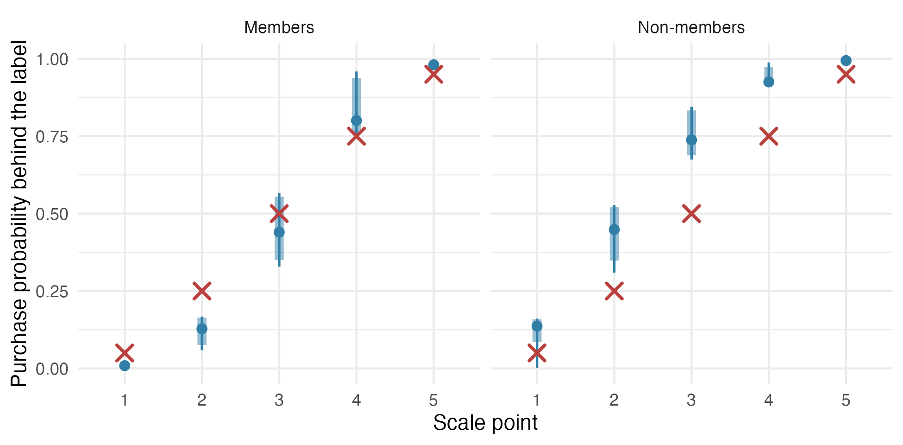
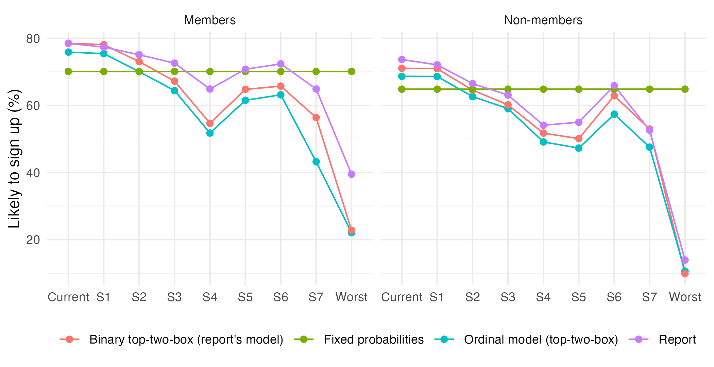



## What this notebook does

Everything before this point has been simulation. This notebook fits the model
to a commercial choice-based conjoint study with an ordinal purchase-likelihood
follow-up, at all three levels of aggregation, runs the specification tests,
and measures what the two practitioner shortcuts cost on real respondents.

**This notebook is not in the project's render list.** The data are a client's
and stay out of the repository; the respondent-level extract and every fit
object live under the gitignored `empirical application/derived/`. The notebook
reads only `R/output/empirical_cobrand.rds`, which holds population-level
estimates, posterior summaries and scenario shares, and is what
`sections/04_analysis.qmd` reads. The pipeline that produces it:

| step | script | what it writes |
|---|---|---|
| ingest | `Rscript R/empirical/run_fits.R ingest` | the derived panel data, one file per segment |
| fits | `Rscript R/empirical/run_fits.R all` | every aggregate and hierarchical fit, cached |
| assemble | `Rscript R/empirical/analyze_cobrand.R` | `R/output/empirical_cobrand.rds`, `R/output/figs/empirical_*.png` |

The study is presented blind: the card, the issuer and the retail partner are
not named, and the attribute labels are generic.

```{r}
#| label: setup
PROJ <- if (file.exists("_quarto.yml")) "." else ".."
res <- readRDS(file.path(PROJ, "R", "output", "empirical_cobrand.rds"))
M <- res$member; NM <- res$nonmember
f0 <- function(x) formatC(x, digits = 0, format = "f")
f1 <- function(x) formatC(x, digits = 1, format = "f")
f2 <- function(x) formatC(x, digits = 2, format = "f")
f3 <- function(x) formatC(x, digits = 3, format = "f")
pct <- function(x, d = 1) paste0(formatC(100 * x, digits = d, format = "f"), "%")
seg_label <- c(member = "Members", nonmember = "Non-members")
```

## 1. The data

A consultancy fielded the study in August 2023 for a card issuer facing a
regulatory cap on late fees: which benefit cuts and fee changes would cost the
fewest sign-ups among prospects, and the least usage among cardholders? We use
the **prospect** sample, because prospects answered a five-point
likelihood-to-sign-up question after each forced choice --- exactly the
probability report the model describes --- while cardholders answered a
four-point usage question that is not one.

| | members | non-members |
|---|---|---|
| respondents | `r M$N` | `r NM$N` |
| tasks per respondent | 12 (`r M$T_est` estimation + `r M$T_hold` holdout) | same |
| alternatives per task | 3, no "none" | 3, no "none" |
| modelled attributes | `r M$P` columns from `r length(M$attributes)` attributes | `r NM$P` columns from `r length(NM$attributes)` attributes |
| follow-up | "how likely would you be to sign up?", 5 points | same |

Members of the issuer's loyalty programme saw the partner-purchase cash-back
attribute fixed at a level outside the tested range, so for them it is a
constant and is dropped; the two segments are fit separately throughout, which
also gives each its own cut points. The forced-choice design is level-balanced
and carries no alternative-specific constants, so the identification condition
holds by construction (checked: `[X, 1]` has full column rank in both
segments). Two holdout tasks per respondent are the last two shown; task order
was randomised, so these are a random pair.

```{r}
#| label: attributes
att <- do.call(rbind, lapply(NM$attributes, function(a)
  data.frame(attribute = a$label, levels = paste(a$levels, collapse = " / "))))
knitr::kable(att, caption = "Attributes and levels (level 1 is the omitted reference).")
```

```{r}
#| label: responses
resp <- rbind(Members = M$descr$y_share, `Non-members` = NM$descr$y_share)
colnames(resp) <- c("very unlikely", "somewhat unlikely", "neither", "somewhat likely", "very likely")
knitr::kable(round(100 * resp, 1), caption = "Distribution of the follow-up (%), all tasks.")
```

Every scale point is used in both segments, which the cut-point starting values
require. There is no drift across task position: the top-two-box share runs
from `r pct(min(M$descr$t2b_by_task))` to `r pct(max(M$descr$t2b_by_task))`
across the twelve positions for members and
`r pct(min(NM$descr$t2b_by_task))` to `r pct(max(NM$descr$t2b_by_task))` for
non-members, with no trend.

## 2. The validation anchor

The consultancy dichotomised the follow-up at top-two-box and fit a binary
dual-response logit --- the incumbent model --- and its report gives the
implied share "likely to sign up" for the current card. The same model fit
here (a $W = 2$ logit hierarchical fit at $k = 4$) reproduces that number:

```{r}
#| label: anchor
anc <- data.frame(
  segment = seg_label,
  report = c(M$scenarios$table$report[1], NM$scenarios$table$report[1]),
  replica = c(M$scenarios$table$binary_t2b_logit[1], NM$scenarios$table$binary_t2b_logit[1]),
  replica_sd = c(M$scenarios$table$binary_t2b_logit_sd[1], NM$scenarios$table$binary_t2b_logit_sd[1]))
knitr::kable(anc, digits = 1, caption = "Current-card sign-up share (%): the consultancy's report vs. our replica of its model.", row.names = FALSE)
```

This fixes three things at once: the choice-to-design alignment in the ingest,
the reading that "likely to sign up" means top-two-box, and the identity of the
incumbent model the rest of the notebook compares against.

## 3. Level 1: aggregate maximum likelihood

```{r}
#| label: agg-table
agg_tab <- function(R) {
  d <- R$agg$table
  data.frame(coefficient = d$coef, estimate = f2(d$beta), `naive se` = f3(d$se),
             `clustered se` = f3(d$se_cl), check.names = FALSE)
}
knitr::kable(agg_tab(M), caption = "Members: aggregate ML, cloglog link.", row.names = FALSE)
knitr::kable(agg_tab(NM), caption = "Non-members: aggregate ML, cloglog link.", row.names = FALSE)
```

Signs and ordering are what the category predicts: every cash-back coefficient
positive and monotone in the rate, every fee and the higher APR negative, the
transit cash-back weakest. The naive standard errors treat each task as
independent; the clustered ones (sandwich by respondent) are the ones to read
on panel data and are `r f2(mean(M$agg$table$se_cl / M$agg$table$se))` times
larger on average for members.

The cut points on the probability scale are the quantities a practitioner can
use: the purchase probability at which each label begins.

```{r}
#| label: agg-alpha
al <- rbind(
  data.frame(segment = "Members", threshold = paste0("alpha_", 1:4), estimate = f3(M$agg$alpha), `clustered se` = f3(M$agg$se_alpha_cl), check.names = FALSE),
  data.frame(segment = "Non-members", threshold = paste0("alpha_", 1:4), estimate = f3(NM$agg$alpha), `clustered se` = f3(NM$agg$se_alpha_cl), check.names = FALSE))
knitr::kable(al, caption = "Aggregate cut points on the probability scale, alpha_w = F(c_w).", row.names = FALSE)
```

## 4. Specification tests, aggregate level

```{r}
#| label: spec-agg
sp <- function(R, seg) {
  s <- R$agg$spec
  data.frame(segment = seg, test = s$test, estimate = f3(s$estimate), `clustered se` = f3(s$se_cl),
             `Wald z (clustered)` = f2(s$wald_z_cl), `p (clustered)` = f3(s$p_wald_cl),
             LR = f1(s$lr), `p (LR)` = f3(s$p_lr), check.names = FALSE)
}
knitr::kable(rbind(sp(M, "Members"), sp(NM, "Non-members")), caption = "Aggregate specification tests. LR statistics are not clustered.", row.names = FALSE)
```

The conditioning test is clean in both segments: $\delta$ is within a
clustered standard error or two of zero, and $\delta = 1$ --- the DR-2Max
reading, in which she grades the product she picked --- is rejected at
$z = `r f1(M$agg$spec$wald_z_cl[3])`$ and $`r f1(NM$agg$spec$wald_z_cl[3])`$.
The unit-slope test rejects, with $\hat\lambda = `r f2(M$agg$spec$estimate[1])`$
and $`r f2(NM$agg$spec$estimate[1])`$, far below one. Section 7 shows that this
aggregate number is not the right one to read.

## 5. Level 2: hierarchical, common cut points

```{r}
#| label: hb-table
hb_tab <- function(R) data.frame(coefficient = R$hb$phibar$coef, `posterior mean` = f2(R$hb$phibar$mean),
                                 `posterior sd` = f3(R$hb$phibar$sd), check.names = FALSE)
knitr::kable(hb_tab(M), caption = "Members: population means of the part-worths, hierarchical cloglog fit.", row.names = FALSE)
knitr::kable(hb_tab(NM), caption = "Non-members: population means of the part-worths, hierarchical cloglog fit.", row.names = FALSE)
```

Sampler settings: `r M$hb$mcmc$R` iterations, `r M$hb$mcmc$burn` burn-in,
thinned by `r M$hb$mcmc$thin`; acceptance `r f2(M$hb$accept$phi)` on the
individual blocks and `r f2(M$hb$accept$zeta)` on the cut-point block for
members. A second seed moves every population mean by at most
`r f2(M$hb$seed_check$max_abs_z)` posterior standard deviations (members) and
`r f2(NM$hb$seed_check$max_abs_z)` (non-members).

```{r}
#| label: hb-alpha
ha <- rbind(
  data.frame(segment = "Members", threshold = paste0("alpha_", 1:4), `posterior mean` = f3(M$hb$alpha),
             `95% interval` = paste0("[", f3(M$hb$alpha_ci[1, ]), ", ", f3(M$hb$alpha_ci[2, ]), "]"), check.names = FALSE),
  data.frame(segment = "Non-members", threshold = paste0("alpha_", 1:4), `posterior mean` = f3(NM$hb$alpha),
             `95% interval` = paste0("[", f3(NM$hb$alpha_ci[1, ]), ", ", f3(NM$hb$alpha_ci[2, ]), "]"), check.names = FALSE))
knitr::kable(ha, caption = "Hierarchical cut points on the probability scale.", row.names = FALSE)
```

The same words carry different probabilities in the two segments: "somewhat
likely" begins at a purchase probability of `r f2(M$hb$alpha[3])` for members
and `r f2(NM$hb$alpha[3])` for non-members.

### Which link?

```{r}
#| label: link
lk <- function(R, seg) with(R$hb$link, data.frame(
  segment = seg, link = c("cloglog (this paper)", "logit (resolved comparison)"),
  WAIC = f1(c(waic_cloglog, waic_logit)), `holdout log-lik` = f1(c(holdout_cloglog, holdout_logit)),
  `holdout hit rate` = f3(c(hit_cloglog, hit_logit)), `LMD (NR)` = f1(c(lmd_nr_cloglog, lmd_nr_logit)), check.names = FALSE))
knitr::kable(rbind(lk(M, "Members"), lk(NM, "Non-members")), caption = "Link comparison, hierarchical fits with common cut points.", row.names = FALSE)
```

At the aggregate level the logit link fits better (bridge-sampling log
marginal likelihoods `r f1(M$agg$lmd$cloglog["bridge"])` vs.
`r f1(M$agg$lmd$logit["bridge"])` for members). At the hierarchical level ---
the level any applied analysis would use --- the ordering reverses decisively:
WAIC favours the cloglog link by `r f0(M$hb$link$waic_logit - M$hb$link$waic_cloglog)`
(members) and `r f0(NM$hb$link$waic_logit - NM$hb$link$waic_cloglog)`
(non-members), and the holdout log-likelihood by
`r f0(M$hb$link$holdout_cloglog - M$hb$link$holdout_logit)` and
`r f0(NM$hb$link$holdout_cloglog - NM$hb$link$holdout_logit)`. Hit rates are
equal, as they must be: the link does not touch the forced choice.

## 6. Level 3: hierarchical, respondent-specific cut points

```{r}
#| label: hetcut
hc <- function(R, seg) data.frame(
  segment = seg, model = c("common cut points", "respondent-specific cut points"),
  WAIC = f1(c(R$hb$waic, R$hetcut$waic)), `holdout log-lik` = f1(c(R$hb$holdout_ll, R$hetcut$holdout_ll)),
  `holdout hit rate` = f3(c(R$hb$hit, R$hetcut$hit)), check.names = FALSE)
knitr::kable(rbind(hc(M, "Members"), hc(NM, "Non-members")), caption = "Common vs. respondent-specific cut points, cloglog link.", row.names = FALSE)
```

Scale-use heterogeneity is large. Letting each respondent carry her own
thresholds improves WAIC by `r f0(M$hb$waic - M$hetcut$waic)` (members) and
`r f0(NM$hb$waic - NM$hetcut$waic)` (non-members), improves the held-out
log-likelihood by `r f0(M$hetcut$holdout_ll - M$hb$holdout_ll)` and
`r f0(NM$hetcut$holdout_ll - NM$hb$holdout_ll)`, and --- because the ordinal
responses stop distorting the individual tastes --- raises the held-out
forced-choice hit rate from `r f3(M$hb$hit)` to `r f3(M$hetcut$hit)` and from
`r f3(NM$hb$hit)` to `r f3(NM$hetcut$hit)`. The population standard deviation
of the first threshold is `r f1(M$hetcut$sd_c1_across_resp)` utility units for
members and `r f1(NM$hetcut$sd_c1_across_resp)` for non-members, against
population part-worths of order one.

```{r}
#| label: hetcut-alpha
qa <- function(R, seg) { q <- R$hetcut$alpha_i_quantiles
  data.frame(segment = seg, quantile = rownames(q), alpha_1 = f3(q[, 1]), alpha_2 = f3(q[, 2]), alpha_3 = f3(q[, 3]), alpha_4 = f3(q[, 4])) }
knitr::kable(rbind(qa(M, "Members"), qa(NM, "Non-members")), caption = "Distribution across respondents of the individual thresholds on the probability scale (posterior means).", row.names = FALSE)
```

Individual thresholds are only partially identified from ten ordinal reports
each, and their posterior means sit at the extremes: for the median member,
"somewhat likely" covers purchase probabilities from
`r f2(M$hetcut$alpha_i_quantiles["50%", 3])` to
`r f2(M$hetcut$alpha_i_quantiles["50%", 4])`. Most respondents use two of the
five scale points, which is what the response distribution of section 1 looks
like through the model. The population distribution of scale usage is the
object recovered here, as the paper says; the individual thresholds are not.

## 7. Specification tests at the hierarchical level

The aggregate tests of section 4 pool heterogeneous respondents, and a pooled
$\overline{\mu}_{it}$ is a noisy proxy for each respondent's own, which
attenuates $\lambda$. The sampler therefore carries a common $\lambda$ or
$\delta$ as an extra block, in both the common-cut and the
respondent-specific-cut model.

```{r}
#| label: spec-hb
ht <- function(R, seg) {
  g <- function(x, nm) if (is.null(x)) NULL else data.frame(
    segment = seg, test = nm, `posterior mean` = f3(x$mean), `posterior sd` = f3(x$sd),
    `95% interval` = paste0("[", f3(x$ci[1]), ", ", f3(x$ci[2]), "]"), null = x$null, check.names = FALSE)
  rbind(g(R$hb_spec$lambda, "lambda, common cuts"), g(R$hb_spec$lambda_hetcut, "lambda, respondent-specific cuts"),
        g(R$hb_spec$delta, "delta, common cuts"), g(R$hb_spec$delta_hetcut, "delta, respondent-specific cuts"))
}
knitr::kable(rbind(ht(M, "Members"), ht(NM, "Non-members")), caption = "Hierarchical specification tests.", row.names = FALSE)
```

**The conditioning test** holds at every level in the sense that matters:
$\delta$ sits near zero throughout, its interval covers zero in five of the six
hierarchical cases (the exception, non-members with common cut points at
`r f2(NM$hb_spec$delta$mean)`, falls on the side away from DR-2Max and
disappears once scale usage is individual), and $\delta = 1$ is far outside
every interval. Respondents grade the set, not the product they picked.

**The unit-slope test** reads differently at each level, and the pattern is
informative rather than contradictory. With common cut points the only way for
the model to fit between-person differences in ordinal *level* --- one
respondent who answers "somewhat likely" to everything, another who answers
"neither" --- is to amplify the between-person spread of $\overline{\mu}_i$,
which pushes $\lambda$ above one
($`r f2(M$hb_spec$lambda$mean)`$ for members). With respondent-specific cut
points absorbing that level, $\lambda$ is identified from *within*-person
variation across tasks, and there the stated likelihood moves
$`r f2(M$hb_spec$lambda_hetcut$mean)`$ (members) and
$`r f2(NM$hb_spec$lambda_hetcut$mean)`$ (non-members) times as far as the
choices say it should: the scale-compression reading of $\lambda < 1$ in the
paper's own taxonomy.

```{r}
#| label: boot
bt <- function(R, seg) {
  b <- R$attenuation
  rows <- list(data.frame(segment = seg, `simulated from` = "common-cut fit",
    `aggregate lambda-hat` = f3(b$lambda_agg_sim_mean), `hierarchical lambda-hat` = f3(b$lambda_hb_sim_mean), check.names = FALSE))
  if (!is.null(b$boot_hetcut)) rows[[2]] <- data.frame(segment = seg, `simulated from` = "respondent-specific-cut fit",
    `aggregate lambda-hat` = f3(mean(b$boot_hetcut$lambda_agg)), `hierarchical lambda-hat` = f3(b$lambda_hetcut_sim_mean), check.names = FALSE)
  do.call(rbind, rows)
}
knitr::kable(rbind(bt(M, "Members"), bt(NM, "Non-members")), caption = "Parametric bootstrap: data simulated from each fitted model with lambda = 1 exactly (three replications), then lambda re-estimated at the aggregate level and in the model it was simulated from.", row.names = FALSE)
```

The bootstrap says what each estimator returns when the truth is one, and the
two rows per segment answer two different questions. Simulating from the
common-cut fit, heterogeneity in tastes alone attenuates the aggregate test to
`r f2(M$attenuation$lambda_agg_sim_mean)`; simulating from the
respondent-specific-cut fit, scale-use heterogeneity of the size estimated
above pulls it to `r f2(mean(M$attenuation$boot_hetcut$lambda_agg))` (members)
and `r f2(mean(NM$attenuation$boot_hetcut$lambda_agg))` (non-members) ---
most of the way to the real-data `r f2(M$attenuation$lambda_agg_real)`. The
common-cut hierarchical estimator returns
`r f2(M$attenuation$lambda_hb_sim_mean)` under a true value of one, so its
real-data `r f2(M$attenuation$lambda_hb_real)` is not shrinkage. The
respondent-specific-cut estimator is biased downward --- it returns
`r f2(M$attenuation$lambda_hetcut_sim_mean)` (members) and
`r f2(NM$attenuation$lambda_hetcut_sim_mean)` (non-members) when the truth is
one, which is what four free thresholds per respondent informed by ten reports
cost --- so its real-data values of `r f2(M$attenuation$lambda_hetcut_real)` and
`r f2(NM$attenuation$lambda_hetcut_real)` should be read against those rather
than against one. They lie a further
`r f2(M$attenuation$lambda_hetcut_sim_mean - M$attenuation$lambda_hetcut_real)`
and `r f2(NM$attenuation$lambda_hetcut_sim_mean - NM$attenuation$lambda_hetcut_real)`
below, several posterior standard deviations: the within-person compression is
real, and smaller than the raw estimate says.

## 8. Practitioner move 1: dichotomise at top-two-box

```{r}
#| label: dichot
dc <- function(R, seg) data.frame(
  segment = seg, model = c("ordinal (this paper)", names(R$dichot$sd_ratio_mean)),
  `posterior sd of population means, relative to ordinal` = f2(c(1, R$dichot$sd_ratio_mean)),
  `holdout hit rate` = f3(R$dichot$hit), check.names = FALSE)
knitr::kable(rbind(dc(M, "Members"), dc(NM, "Non-members")), caption = "Binary dual-response fits at the top-two-box (t2b) and top-box (top) cuts, both links.", row.names = FALSE)
```

Collapsing the scale costs precision and nothing else: the posterior standard
deviations of the population part-worths are
`r pct(M$dichot$sd_ratio_mean["t2b_logit"] - 1, 0)` larger for the incumbent
top-two-box logit among members and
`r pct(NM$dichot$sd_ratio_mean["t2b_logit"] - 1, 0)` among non-members, while
holdout hit rates are within sampling error of one another. The consultancy's
report recovered thresholds by fitting a *sequence* of binary models, one per
cut; the ordinal model returns all four from one fit:

```{r}
#| label: stepwise
st <- function(R, seg) { s <- R$dichot$stepwise
  data.frame(segment = seg, `cut point` = s$cut, `four binary logit fits` = paste0(f2(s$binary_mean), " (", f3(s$binary_sd), ")"),
             `one ordinal logit fit` = paste0(f2(s$ordinal_mean), " (", f3(s$ordinal_sd), ")"), check.names = FALSE) }
knitr::kable(rbind(st(M, "Members"), st(NM, "Non-members")), caption = "Cut points (posterior mean and sd) from four separate binary fits vs. one ordinal fit, logit link in both.", row.names = FALSE)
```

## 9. Practitioner move 2: fixed probabilities per label

The other shortcut attaches a constant to each label
(`r paste(res$settings$wts_juster, collapse = " / ")`) and averages. The model
says what each label is actually worth, task by task:

```{r}
#| label: label-worth
lw <- function(R, seg) { d <- R$fixedprob$label_worth
  data.frame(segment = seg, label = d$label, `fixed constant` = f2(d$fixed), `model: 10th pct` = f2(d$q10),
             `model: median` = f2(d$median), `model: 90th pct` = f2(d$q90), check.names = FALSE) }
knitr::kable(rbind(lw(M, "Members"), lw(NM, "Non-members")), caption = "E[p | y = w, task] across the estimation tasks, hierarchical cloglog fit, vs. the fixed constants.", row.names = FALSE)
```



The constants are wrong for every label, in both directions, and the same
label is worth different probabilities in the two segments: "somewhat likely"
is `r f2(M$fixedprob$label_worth$median[4])` for members and
`r f2(NM$fixedprob$label_worth$median[4])` for non-members.

## 10. The consultancy's scenarios

The report evaluates nine card configurations, from the current offer to a
worst case. Each is a single card, so $S = e^{V(x)}$ and the share likely to
sign up is $\Pr(y \ge 4 \mid x)$.

```{r}
#| label: scenarios
sc <- function(R, seg) { d <- R$scenarios$table
  data.frame(segment = seg, scenario = d$scenario, report = f1(d$report),
             `ordinal (t2b)` = paste0(f1(d$ordinal_t2b), " (", f1(d$ordinal_t2b_sd), ")"),
             `binary t2b logit` = f1(d$binary_t2b_logit), `ordinal (top box)` = f1(d$ordinal_top),
             `binary top logit` = f1(d$binary_top_logit), `fixed probabilities` = f1(d$heur_juster),
             `resp.-specific cuts (t2b)` = f1(d$hetcut_t2b), check.names = FALSE) }
knitr::kable(rbind(sc(M, "Members"), sc(NM, "Non-members")), caption = "Share likely to sign up (%) by scenario and method. The report column is the consultancy's own simulator and anchors the Current row; the posterior sd of the ordinal share is in parentheses.", row.names = FALSE)
```



The three models agree closely with one another. The fixed-probability
heuristic cannot see the scenario at all: its incidence is a constant computed
from observed label shares, so it reports
`r f1(M$scenarios$table$heur_juster[1])`% for the current card and the same
number for the worst case. The binary top-two-box model matches the ordinal
model at the top-two-box margin and has nothing to say at the top-box margin;
the ordinal model answers both from one fit. The report's own line declines
more gently than any of the three in the middle scenarios; that is its
simulator and prior scaling, which we cannot reproduce without its utilities,
so the report column should be read as the anchor at Current rather than as a
standard elsewhere.

## 11. Diagnostics

| | members | non-members |
|---|---|---|
| ordinal fit runtime (min) | `r f1(M$hb$runtime_min)` | `r f1(NM$hb$runtime_min)` |
| acceptance, individual blocks | `r f3(M$hb$accept$phi)` | `r f3(NM$hb$accept$phi)` |
| acceptance, cut-point block | `r f3(M$hb$accept$zeta)` | `r f3(NM$hb$accept$zeta)` |
| log-likelihood, first vs. second half of kept draws | `r f0(M$hb$ll_trace_halves[1])` / `r f0(M$hb$ll_trace_halves[2])` | `r f0(NM$hb$ll_trace_halves[1])` / `r f0(NM$hb$ll_trace_halves[2])` |
| second seed, max shift in population means (sd units) | `r f2(M$hb$seed_check$max_abs_z)` | `r f2(NM$hb$seed_check$max_abs_z)` |
| tasks with two identical displayed concepts | `r M$duplicates$n_tasks` of `r M$duplicates$n_total` | `r NM$duplicates$n_tasks` of `r NM$duplicates$n_total` |

The identical-concept tasks come from one design version in which two cards
differed only on the attribute members do not see; the multinomial logit
splits probability between identical rows and the tasks are kept.
